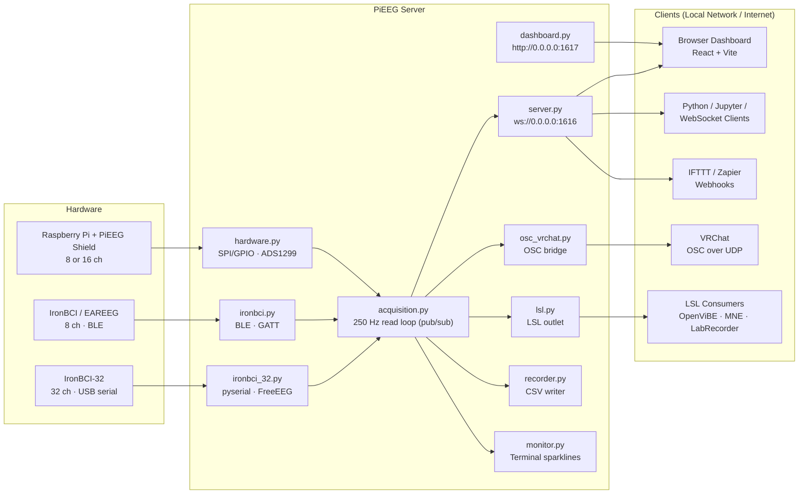

import { Cards, Callout, Steps } from 'nextra/components'

<div style={{
  textAlign: 'center',
  padding: '3.5rem 0 2.5rem',
  marginBottom: '2.5rem',
  borderBottom: '1px solid rgba(128,128,128,0.15)'
}}>
  <div style={{
    display: 'inline-block',
    fontSize: '0.75rem',
    fontWeight: 700,
    letterSpacing: '0.12em',
    textTransform: 'uppercase',
    color: 'hsl(200, 80%, 50%)',
    marginBottom: '1rem'
  }}>Open-Source Brain-Computer Interface</div>

  <h1 style={{
    fontSize: 'clamp(2rem, 5vw, 2.8rem)',
    fontWeight: 800,
    letterSpacing: '-0.03em',
    lineHeight: 1.1,
    margin: '0 0 1.1rem'
  }}>PiEEG Documentation</h1>

  <div style={{
    fontSize: '1.1rem',
    opacity: 0.65,
    maxWidth: '560px',
    margin: '0 auto 2rem',
    lineHeight: 1.7
  }}>
    From electrode wiring to live WebSocket streams — complete coverage of
    PiEEG hardware, PiEEG Server software, and all integrations.
  </div>

  <div style={{ display: 'flex', gap: '0.875rem', justifyContent: 'center', flexWrap: 'wrap' }}>
    <a
      href="/software/getting-started/quick-start"
      style={{
        padding: '0.65rem 1.5rem',
        background: 'hsl(200, 80%, 48%)',
        color: '#fff',
        borderRadius: '7px',
        fontWeight: 600,
        textDecoration: 'none',
        fontSize: '0.95rem'
      }}
    >Quick Start</a>
    <a
      href="/hardware"
      style={{
        padding: '0.65rem 1.5rem',
        border: '1px solid rgba(128,128,128,0.3)',
        borderRadius: '7px',
        fontWeight: 600,
        textDecoration: 'none',
        fontSize: '0.95rem'
      }}
    >Browse Hardware</a>
  </div>
</div>

## What Is PiEEG?

PiEEG is an open biosignal data platform for building brain-computer interfaces. It brings together hardware, software, AI models, and a global community of researchers, engineers, and makers.

- **Hardware**: Brain-computer interfaces from 1 to 48 channels, in wearable and stationary form factors, with support for both dry and wet electrodes. Devices run on a Raspberry Pi, Jetson Nano, or standalone USB host and record EEG, EMG, ECG, and EOG.  
- **Software**: **PiEEG Server** acquires, streams, records, and exposes real-time biosignal data over WebSocket, LSL, OSC, and webhooks, with a built-in browser dashboard out of the box.
- **AI models**: Ready-to-use models and tools for signal processing, classification, and real-time BCI applications.
- **Community**: Competitions and hackathons where people share projects, datasets, and ideas to push neurotechnology forward.

<Callout type="info">
  New to PiEEG? Follow the [Quick Start](/software/getting-started/quick-start) to get streaming in minutes. Setting up hardware for the first time? Start with [Hardware](/hardware) and pick your device.
</Callout>

## Explore the Docs

<Cards>
  <Cards.Card title="Hardware Overview" href="/hardware" />
  <Cards.Card title="All Devices" href="/hardware/devices" />
  <Cards.Card title="Accessories" href="/hardware/accessories" />
  <Cards.Card title="Signal Quality" href="/hardware/signal-quality/noise-elimination" />
  <Cards.Card title="Software" href="/software" />
  <Cards.Card title="Cloud (cloud.pieeg.com)" href="/cloud" />
  <Cards.Card title="octoBridge" href="/software/octobridge" />
  <Cards.Card title="octoWatch (Garmin)" href="/software/octowatch" />
  <Cards.Card title="Quick Start" href="/software/getting-started/quick-start" />
  <Cards.Card title="Integrations" href="/software/integrations" />
  <Cards.Card title="API Reference" href="/software/api/websocket" />
  <Cards.Card title="About PiEEG" href="/about" />
</Cards>

## What's Covered

| Area | Topics |
|------|--------|
| **Hardware** | PiEEG, PiEEG-16, JNEEG, ardEEG, IronBCI, MicroBCI, IronBCI-32, electrodes, caps, power |
| **Software** | Server install, dashboard, [experiences gallery](/software/features/experiences), WebSocket streaming, data format, recording, detectors |
| **Cloud** | cloud.pieeg.com, browser streaming (Web Bluetooth / Web Serial), [BrainFlow Devices](/cloud/brainflow), [Live Lab](/cloud/live-lab), [PiEEG Studio (MNE)](/cloud/studio), [experiences gallery](/software/features/experiences), [Buddy AI](/cloud/buddy) (live neural copilot) |
| **octoBridge** | [octobridge.pieeg.com](https://octobridge.pieeg.com/) - classroom lab for Octopus-16 and the octoBio Kit. See [octoBridge](/software/octobridge). |
| **octoWatch** | [Garmin Connect IQ Store](https://apps.garmin.com/apps/8e994535-c853-45ca-abe3-ccef61119c8b) - stream 16-channel 250 SPS EEG from Octopus-16 directly to your Garmin watch. See [octoWatch](/software/octowatch). |
| **Integrations** | LSL, Jupyter notebooks, VRChat OSC, webhooks, IFTTT, Zapier |
| **Operations** | Authentication, security, troubleshooting, development, signal quality |

## Install the Server

<Steps>
### One-line install (Linux / Raspberry Pi OS)

```bash
curl -sSL https://raw.githubusercontent.com/pieeg-club/PiEEG-server/main/install.sh | bash
```

### Open the dashboard

Navigate to `http://<device-ip>:1617` in your browser.

### Stream data

Connect any WebSocket client to `ws://<device-ip>:1616`.
</Steps>

## Platform Architecture


