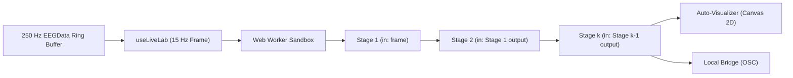

import { Callout, Cards } from 'nextra/components'

# Live Lab (Bio-Pen)

**Live Lab** is the programmable biosignal workbench built into [cloud.pieeg.com/lab](https://cloud.pieeg.com/lab) (and the self-hosted dashboard at `/lab`). It runs a reactive chain of JavaScript cells inside a dedicated Web Worker at 15 Hz against the live 250 Hz multichannel ring buffer.

Opening `/lab` or any shared `/lab/:penId` link boots directly into the workbench. If no physical board is connected yet, the workbench automatically starts an 8-channel 250 Hz simulated stream (`demo:8`) so pipelines run immediately.

<Callout type="info">
  **Honest metrics:** Within-session Cohen's *d* and Leave-One-Rep-Out cross-validation (`loroCV`) scores measure class separation within the current electrode placement and session. They are descriptive within-session diagnostics, not cross-subject or cross-day generalisation claims.
</Callout>

## Architecture & Live Loop

1. **Main-thread host (`useLiveLab`)**: Extracts the latest 2-second window per channel (`win[ch]`) from the 250 Hz ring buffer alongside shared detector outputs (`bands`, `focus`, `relax`) and posts a `LabFrame` to the sandbox worker at 15 Hz.
2. **Debounced editing**: Code edits are debounced by 450 ms before recompiling in the worker so typing never flickers the canvas. If a line has a temporary syntax or runtime error, the last valid plot remains on screen while a compact diagnostic bar reports the error below the plot.
3. **Freeze 2s Window**: Clicking **Freeze 2s Window** snapshots the current 2-second multichannel buffer and feeds that exact frozen frame on every tick so you can iterate on filters and classifiers deterministically.

---

## Sandbox Scope & `bio` Primitives

Every stage cell runs in strict mode with the following identifiers pre-bound in scope:

### Frame & State Inputs

| Identifier | Type | Description |
|---|---|---|
| `input` | `unknown` | Return value of the previous stage (for Stage 1, `input` is `frame`) |
| `frame` | `LabFrame` | Full tick payload (`{ ts, fs, numChannels, win, EEG, bands, focus, relax }`) |
| `win` | `number[][]` | Last 2 seconds of raw samples per channel: `win[ch][sampleIdx]` in µV |
| `EEG` | `number[]` | Latest instantaneous sample per channel in µV |
| `bands` | `LabBands` | `{ delta, theta, alpha, beta, gamma, relative, totalPower, dominantFrequency }` |
| `focus` | `number` | Engagement index in `[0, 1]` |
| `relax` | `number` | Relaxation index in `[0, 1]` |
| `fs` | `number` | Active sample rate in Hz (e.g. `250`) |
| `dataset` | `LabDataset` | Session epochs `{ X, y, reps, labels, featureNames }` |
| `state` | `Record<string, any>` | Persistent per-stage object preserved across ticks (for EMAs, counters, refractory gates) |

### DSP, Statistics & Classifier Functions

| Function | Signature | Description |
|---|---|---|
| `car` | `car(win)` | Common Average Reference across all channels at each sample |
| `bipolar` | `bipolar(chA, chB)` | Sample-by-sample difference `chA[t] - chB[t]` |
| `detrend` | `detrend(series)` | Subtract arithmetic mean (DC offset removal) |
| `zscore` | `zscore(series)` | Standardize 1D series to zero mean and unit variance |
| `mean` / `std` / `variance` | `mean(series)` | Basic sample statistics |
| `rms` | `rms(series)` | Root-mean-square amplitude in µV |
| `lineLength` | `lineLength(series)` | Mean absolute first difference (`mean(\|x[t] - x[t-1]\|)`) |
| `slopeSignChanges` | `slopeSignChanges(series, deadband?)` | Rate of slope sign inversions exceeding `deadband` (default `0.5` µV) |
| `fft` | `fft(series)` | Hann-windowed radix-2 Cooley-Tukey magnitude spectrum |
| `psd` | `psd(series, fs?, maxHz?)` | Power spectral density `{ freqs, power, peakHz }` |
| `bandpower` | `bandpower(series, [lo, hi], fs?)` | Mean power within `[lo, hi]` Hz |
| `cohensD` | `cohensD(groupA, groupB)` | Within-session standardized mean difference |
| `features` | `features(frame?)` | Extracts a 13-D spectral + time-domain feature vector from a frame |
| `lda` | `lda(X, y, shrinkage?)` | Closed-form Shrinkage-LDA classifier (`predict(x)`, `predictProba(x)`) |
| `logreg` | `logreg(X, y, opts?)` | L2-regularised multinomial logistic regression (`{ epochs, lr, l2 }`) |
| `loroCV` | `loroCV(X, y, reps, kind?)` | Trial-grouped Leave-One-Rep-Out cross-validation (`{ accuracy, balancedAccuracy, folds, confusion }`) |
| `crossValScore` | `crossValScore(X, y, k?, kind?)` | Stratified sample-level *k*-fold cross-validation |
| `check` | `check(condition, message)` | Pass/fail assertion displayed in the stage footer |

---

## Return-Driven Auto-Visualizer

You do not need boilerplate plotting code. Whatever value a stage returns is automatically classified and drawn on its `#1e242c` canvas:

| Returned Value | Rendered Visualization |
|---|---|
| `number` or `{ value, unit }` | Large monospace readout + rolling 120-tick sparkline with min/max bounds |
| `number[]` (more than 16 items) | Time-domain waveform trace with zero-line and peak amplitude scale |
| `number[]` (up to 16 items) or `{ labels, values }` | Color-coded bar chart with per-bar numeric readouts |
| `number[][]` (more than 24 samples per row, e.g. `car(win)`) | Waveform trace of channel 1 from the spatial matrix |
| `{ freqs, power, peakHz? }` | Power spectrum curve with 8-12 Hz alpha band highlight |
| `{ matrix, labels?, title? }` | 2D heatmap / confusion matrix with cell values |
| `{ label, probs, loroBalancedAccuracy? }` | Live BCI decoder readout with class probability bars and LORO-CV badge |

---

## Session Dataset & Decoder Arena

The **Session Dataset** bar at the top of `/lab` records 2-second labelled epochs from the live stream into `dataset` (`{ X, y, reps, labels, featureNames }`):

1. Click **`+ Record "rest" (2s)`**, **`+ Record "active" (2s)`**, or enter any custom class label. Each button press increments the repetition counter `reps[i]` and captures feature vectors across the 2-second hold.
2. To test classifiers without recording physical trials first, click **Seed Demo Epochs** to populate a deterministic 12-trial (`6 reps x 2 classes`) dataset.
3. Click **Arena** in the header to open the **Decoder Arena** benchmark table. It evaluates your pipeline's decoder output side-by-side against reference **Shrinkage-LDA** and **L2 Logistic Regression** models on:
   - **Honest LORO-CV (Balanced Accuracy)**: Holds out entire recording repetitions so temporally adjacent windows from the same trial never leak between train and test sets.
   - **Sample k-Fold (Leakage Check)**: Shows how naive random window splitting inflates accuracy on autocorrelated biosignals.
   - **Within-Session Cohen's *d***, inference latency (ms), and live class predictions.

---

## Saving, Sharing & Forking Bio-Pens

Every pipeline can be saved and shared via three mechanisms:

1. **One-Click Cloud Permalinks (`/lab/:id`)**:
   - Press `Ctrl+S` (`Cmd+S`) or click **Save & Share** in the header.
   - Works in **guest mode** (no login required) as well as signed-in accounts.
   - On creation (`POST /v1/pens`), the server returns a cryptographic `editToken` stored in your browser's `localStorage` and verified via the `X-Pen-Token` header (SHA-256 timing-safe match). Only the creator (via account JWT or `X-Pen-Token`) can `PATCH` or `DELETE` that pen; any other visitor who edits and saves automatically mints a new forked `/lab/:newId` and increments the parent pen's `forkCount`.
   - Every visit to `/lab/:id` increments `viewCount`. Open **Explore / Export** to browse community pens sorted by **Most Visited** (`?sort=popular`), **Recent**, or **Mine**.
2. **Self-Contained Inline URLs (`/lab?pen=...`)**:
   - Encodes the pipeline stages into a compact base64url query string that requires no database lookup.
3. **Portable `.biopen.json` Bundles**:
   - Export or import the full pipeline (including the recorded `dataset` feature matrix) as a local JSON file.

### REST API Endpoints (`/v1/pens`)

| Method | Path | Auth | Description |
|---|---|---|---|
| `GET` | `/v1/pens` | Optional | List public pens (`?sort=popular` or `?sort=recent`), or caller's own pens (`?mine=true` with Bearer JWT) |
| `GET` | `/v1/pens/:id` | Optional | Fetch a pen by UUID and atomically increment `viewCount` |
| `POST` | `/v1/pens` | Optional | Create a new pen (or fork when `forkedFromId` is set); returns one-time `editToken` |
| `PATCH` | `/v1/pens/:id` | Owner JWT or `X-Pen-Token` | Update title, description, visibility, stages, checks, or dataset |
| `DELETE` | `/v1/pens/:id` | Owner JWT or `X-Pen-Token` | Delete pen (`204 No Content`) |

---

## Streaming Output to OSC (Local Bridge)

Check **Stream final stage to Local Bridge (OSC)** in the dataset strip to forward your pipeline's final stage output over the WebRTC [Local Bridge](/cloud/local-bridge):

- If the final stage returns a number `v`, it streams to `/pieeg/lab/value`.
- If the final stage returns an object (such as `{ alpha, beta, ratio }` or `{ label, probs: { rest, active } }`), every finite numeric field and probability (`prob_rest`, `prob_active`) is batched into a single OSC frame at 10 Hz.

<Cards>
  <Cards.Card title="Open Live Lab" href="https://cloud.pieeg.com/lab" />
  <Cards.Card title="Detectors Reference" href="/software/features/detectors" />
  <Cards.Card title="Local Bridge (OSC)" href="/cloud/local-bridge" />
</Cards>
