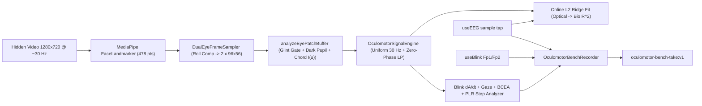

import { Callout, Cards } from 'nextra/components'

# Oculomotor, Blink & Pupillometry Bench

A dual-eye video-oculography (VOG), blink morphology, and visible-light pupillometry recording bench in the [experiences gallery](/software/features/experiences). Rather than displaying a full-face webcam feed, it locks onto the medial and lateral canthi of both eyes, compensates head roll angle to 0 deg, and isolates only the two zoomed periocular eye scopes (**OD · Right Eye** and **OS · Left Eye**) alongside the pixel-level computer vision and electrophysiological coupling models running behind the scenes.

Open it from **cloud.pieeg.com** -> **`V`** -> **Oculomotor, Blink & Pupillometry Bench**. Registry id: `oculomotor-bench`. Tag: `Lab / Oculomotor`.

<Callout type="warning">
  Every output in the bench is tagged with an explicit measurement tier. Roll-rectified eye crops, palpebral aperture ratios, and chord luminance profiles (Tier 1) depend on ambient illumination and camera exposure. Iris-normalized pupil ratios, eyelid velocities, and canthus-referenced gaze angles (Tier 2) require adequate iris-to-pupil contrast and are bounded by the 30 Hz frame integration window. Pupillary Light Reflex (PLR) step metrics, Bivariate Contour Ellipse Area (BCEA), and Optical-to-Bio L2 Ridge Regression weights (Tier 3) are experimental research metrics: they are **not** equivalent to 850 nm dark-pupil infrared clinical eye trackers or hardware-triggered EOG amplifiers.
</Callout>

## Three-tier measurement taxonomy

The bench separates direct periocular pixel readouts from geometric/kinematic estimates and experimental reflex/coupling models in both the UI (`TierBadge`) and exported files (`OCULOMOTOR_CAVEATS`):

| Tier | Identifier | Badge | What it includes |
|---|---|---|---|
| **Tier 1** | `direct_optical` | `T1 · Direct Optical` | Roll-rectified `96x56` periocular RGBA crops (`OD` and `OS`), inter-canthal span (px), normalized palpebral fissure aperture ratio (`L_lid / W_canthus`), horizontal iris chord luminance profile `I(u)` (0-255 DN), and mean periocular luminance. |
| **Tier 2** | `algorithm_estimate` | `T2 · Algorithm Estimate` | Corneal Purkinje glint exclusion (`>= glintThresholdDn`), adaptive dark-pupil pixel segmentation, dimensionless pupil-to-iris diameter ratio (`D_pupil / D_iris`), zero-phase lowpass filtered pupil trace, central-difference eyelid velocity `dA/dt` (units/s), and canthus-referenced gaze azimuth/elevation (deg). |
| **Tier 3** | `experimental_metric` | `T3 · Experimental Metric` | Pupillary Light Reflex (PLR) step constriction amplitude (%), constriction latency (ms), peak constriction velocity, and `T63` recovery (ms); 68% Bivariate Contour Ellipse Area (`BCEA` in deg²); pupillary hippus PSD (`0.05 - 1.50 Hz`); and online L2 Ridge Regression (`R²`, `r_blink`, standardized beta weights) mapping optical eye kinematics to concurrent PiEEG bio channels. |

## What it is (and is not)

| It is | It is not |
|---|---|
| A dual-eye roll-stabilized periocular scope (`OD` and `OS` only; full face is never rendered) | A full-frame selfie webcam viewer or video archive |
| Glass-box pixel segmentation (live switch between Rectified RGB, ML Pixel Mask, and Sobel Edge gradient) | An opaque black-box gaze or pupil number without pixel verification |
| Distance-invariant pupillometry normalized by visible iris diameter (`D_pupil / D_iris`) | An 850 nm infrared dark-pupil clinical pupillometer |
| Online L2 Ridge Regression coupling optical eye kinematics to live PiEEG channels | Hardware-triggered microsecond ocular dipole source localization |
| Timestamped optical + bio time-series recorder with offline parameter reprocessing | A diagnostic neuro-ophthalmology medical device |

## Live loop



1. **Hidden high-resolution acquisition** - `getUserMedia` requests `1280x720` at `30 Hz` (`facingMode: "user"`) into an offscreen `<video style={{ display: "none" }}>` element. The full face frame is never drawn to the screen, maximizing pixel density across the iris while keeping screen space dedicated to the two periocular instruments.
2. **Bilateral canthal lock & roll rectification** - `DualEyeFrameSampler` extracts the outer and inner canthi for the right eye (`OD`: landmarks `33, 133`) and left eye (`OS`: landmarks `362, 263`), computes the inter-canthal roll angle `theta_roll = atan2(dy, dx)`, and affine-transforms each periocular region into a roll-stabilized `96x56` canvas so the palpebral fissure remains strictly horizontal even during head tilt.
3. **Behind-the-scenes pixel segmentation & chord profiling** - `analyzeEyePatchBuffer` computes red-weighted luminance `I(x, y) = 0.52 R + 0.36 G + 0.12 B` (which increases melanin boundary contrast in visible light), evaluates the 2D Sobel gradient magnitude `|grad I|`, masks specular corneal Purkinje glints above `glintThresholdDn`, and segments the dark pupil core against the surrounding iris stroma annulus.
4. **Blink hold-last-valid & uniform 30 Hz resampling** - `OculomotorSignalEngine` resamples non-uniform camera timestamps onto a uniform `30 Hz` grid (`UNIFORM_OCULO_HZ = 30`), holds pupil diameter across brief eyelid closures (`apertureRatio < 0.14`) so blink occlusion does not inject false constriction spikes, and applies forward-backward zero-phase 2nd-order Butterworth lowpass filtering (`lowpassZeroPhase`).
5. **Online Optical-to-Bio L2 Ridge Coupling** - Concurrent PiEEG bio frames from `subscribeEegSamples` are interpolated onto the uniform window and fit via L2-regularized least squares against four standardized optical predictors: `[eyelidClosure, eyelidVel, gazeAzimuth, gazeElevation]`.

## Five-panel workbench layout

| Panel | Surface | Contents |
|---|---|---|
| **Panel 1** | Dual Roll-Stabilized Eye Scopes (`T1`) | Side-by-side `OD · Right Eye` and `OS · Left Eye` zoomed viewports (`96x56` aspect), pixel layer switcher (**Rectified RGB + Mesh**, **ML Pixel Mask**, **Sobel Edge \|grad I\|**), **Trigger PLR Flash** button, and oculomotor stimulus selector (`No Target`, `Saccade Steps`, `Smooth Pursuit`). |
| **Panel 2** | Real-Time Oculomotor, Pupillary & Bio Coupling Signals | 5-lane high-DPI scope: (1) Palpebral Fissure Aperture Ratio (`OD`/`OS`) + blink peak markers, (2) Iris-Normalized Pupil Ratio (`D_pupil / D_iris`) + shaded photic flash band, (3) Eyelid Velocity `dA/dt` + Saccade Speed (`deg/s`), (4) Gaze Azimuth, Elevation, and Binocular Vergence (`deg`), and (5) L2 Ridge Predicted vs. Measured Bio channel (`uV`), plus the collapsible **Live Biosignals Dock**. |
| **Panel 3** | Pixel Chord Profile & ML Coupling (`T2` / `T3`) | Left split: live 1D horizontal iris chord intensity profile `I(u)`, radial derivative `\|dI/du\|`, iris stroma mean `I_iris`, and adaptive dark-pupil threshold `T_pupil`. Right split: switchable between **2D Cyclopean Gaze & 68% BCEA Ellipse** and **Bio R² Bars**, followed by the **PLR Reflex & Blink Kinematics** card and **Optical-to-Bio L2 Ridge Coupling** table. |
| **Panel 4** | Pixel Segmentation & DSP Controls | Dark-pupil threshold fraction (`alpha`), Purkinje glint ceiling (`DN`), pupil zero-phase lowpass cutoff (`Hz`), iris-pupil contrast SNR gate (`dB`), L2 ridge penalty (`lambda`), analysis window (`6, 10, 15, 20 s`), **Reprocess Take**, and **Reference Validation Dataset Loader**. |
| **Panel 5** | Recording & Session Export | Session metadata (`sessionName`, `subjectId`, `lightingCondition`, `notes`), manual event marker input (`M`), Start/Stop recording (`Space`), CSV export, JSON export, and JSON session import. |

## Behind-the-scenes pixel segmentation & chord profile

Clicking the `OD` or `OS` viewport in Panel 1 (or the **Inspect OD / OS Pixels** buttons in Panel 3) selects that eye for pixel-level inspection.

### Three viewport pixel modes (Panel 1)

| Mode | Identifier | What is rendered in the zoomed eye scopes |
|---|---|---|
| **Rectified RGB + Mesh** | `rectified_rgb` | Roll-stabilized periocular RGB pixels overlaid with upper/lower eyelid arcs (pink), fitted iris limbus circle (emerald), fitted dark-pupil boundary (cyan), pupil centroid crosshair (yellow), and horizontal chord sampling line. |
| **ML Pixel Mask** | `pixel_segmentation` | Per-pixel classification buffer `segMask`: **Class 2** = Dark pupil core (cyan), **Class 1** = Iris stroma annulus (emerald), **Class 3** = Excluded corneal Purkinje I reflection (amber/gold), **Class 4** = Eyelid margin anchor (pink), **Class 0** = Sclera / periocular background (slate). |
| **Sobel Edge \|grad I\|** | `sobel_gradient` | 3x3 Sobel gradient magnitude `hypot(Gx, Gy)` on red-weighted luminance, highlighting the limbus and pupillary margin step edges. |

### Adaptive dark-pupil threshold & iris normalization

To prevent head `Z`-distance movements from masquerading as pupil dilation, the bench measures the pupil diameter `D_pupil` relative to the visible iris diameter `D_iris` (`11.7 mm` anatomical reference):

1. **Iris stroma annulus (`0.58 <= r / R_iris <= 0.92`)**: Excluding pixels above `glintThresholdDn` (default `232 DN`) and upper/lower eyelid zones, the 60th percentile luminance estimates `I_iris`.
2. **Dark pupil core (`r / R_iris <= 0.38`)**: The 20th percentile luminance estimates `I_min`.
3. **Adaptive threshold (`T_pupil`)**:
   ```
   T_pupil = I_min + alpha * max(4, I_iris - I_min)
   ```
   where `alpha` is configurable in Panel 4 (`pupilThresholdAlpha`, default `0.38`).
4. **Iris-to-pupil contrast SNR (dB)**:
   ```
   SNR_contrast_dB = 10 * log10( (I_iris - I_min)^2 / Var(I_stroma) )
   ```
   When `SNR_contrast_dB < minContrastSnrDb` (default `3.0 dB`), `pupilGatedPass` trips to `false`.
5. **Combined area + chord radius**: The dark-pupil radius combines the 2D segmented pixel area (`sqrt(A_pupil / pi)`) and the 1D horizontal chord width below `T_pupil` (`0.6 * R_area + 0.4 * R_chord`), yielding `pupilIrisRatio = R_pupil / R_iris`.

## Oculomotor, blink & PLR algorithms

### Ballistic blink kinematics (`detectBlinkKinematics`)

Spontaneous and voluntary blinks exhibit an asymmetric velocity profile: fast ballistic closure driven by the orbicularis oculi (`dA/dt < 0`) followed by slower opening driven by the levator palpebrae superioris (`dA/dt > 0`).

- **Baseline**: 75th percentile of binocular palpebral aperture `A(t)` over the analysis window.
- **Closure gate**: `A(t) < max(0.06, 0.62 * A_baseline)` with duration between `65 ms` and `950 ms` and peak closing speed `|min(dA/dt)| > 0.35 /s`.
- **Reported metrics**: `durationMs`, `minApertureRatio`, `peakClosingVelPerSec`, `peakOpeningVelPerSec`, and `velocityRatio = |peakClosingVel| / peakOpeningVel`.

### Pupillary Light Reflex (PLR) step analyzer (`analyzePlrAndHippus`)

Clicking **⚡ Trigger PLR Flash** in Panel 1 applies a `3.5 s` high-luminance screen bezel step (`stimulus.luminance01: 0.10 -> 0.95`) and logs a `plr_flash_onset` marker. Across any rising stimulus step in the active window, `analyzePlrAndHippus` computes:

- **Baseline ratio (`baselineRatio`)**: Mean `D_pupil / D_iris` over the `1.2 s` preceding flash onset.
- **Constriction latency (`latencyMs`)**: Delay from flash onset (`t_flash`) to the first sample (`t >= t_flash + 140 ms`) where pupil ratio drops by at least `0.015` and constriction velocity `d(D/D_iris)/dt < -0.06 /s`.
- **Constriction amplitude (`constrictionPct`)**: `(baselineRatio - minConstrictedRatio) / baselineRatio * 100%`.
- **Peak constriction velocity (`maxConstrictionVelPerSec`)**: Maximum downward slope `-min(d(D/D_iris)/dt)` during the constriction phase.
- **Redilation recovery (`recoveryT63Ms`)**: Time after minimum constriction required to recover `63.2%` (`1 - 1/e`) of the constriction amplitude.
- **Hippus PSD**: Hann-windowed discrete Fourier transform of the demeaned pupil ratio across `[0.05 Hz, 1.50 Hz]` at `0.025 Hz` resolution.

### Fixation stability (`computeBceaDeg2`)

Fixation dispersion is quantified by the 68% Bivariate Contour Ellipse Area (`BCEA`, `k = 1.14`) across horizontal azimuth `sigma_x` and vertical elevation `sigma_y` (in visual degrees):

```
BCEA_68 = 2 * k * pi * sigma_x * sigma_y * sqrt(1 - rho_xy^2)
```

### Online Optical-to-Bio L2 Ridge Coupling (`fitOpticalBioCoupling`)

The corneal-retinal standing potential (~0.4 to 1.0 mV, cornea positive relative to retina) and eyelid sliding capacitance project strongly onto frontal and periocular EEG/EOG electrodes. Over the uniform 30 Hz window (`N` samples), the bench standardizes four optical predictors:

- `x_0(t) = -zscore(apertureWave)` (eyelid closure)
- `x_1(t) = zscore(eyelidVelocityWave)` (`dA/dt`)
- `x_2(t) = zscore(gazeAzimuthDegWave)` (horizontal gaze)
- `x_3(t) = zscore(gazeElevationDegWave)` (vertical gaze)

For each active PiEEG bio channel `y_c(t)`, the bench solves the 4x4 L2-regularized normal equations via Gaussian elimination with partial pivoting:

```
beta_c = ( (1/N) X^T X + lambda * I_4 )^-1 * ( (1/N) X^T z_c )
```

where `lambda` is `config.ridgeLambda` (default `0.15`). Panel 2 overlays the reconstructed ocular prediction `y_hat_c(t)` (in `uV`) directly on top of the measured bio channel `y_c(t)`, while Panel 3 reports the explained variance `R²` (`0 - 100%`), zero-lag blink correlation `r_blink`, and standardized weights `beta_close`, `beta_Az`, `beta_El`.

## Two clocks & technical validation strip

Optical frames and PiEEG bio samples are captured on independent browser arrival clocks anchored to a shared session `t0Sec`:

| Stream | Timestamp at ingest | Source | Typical rate |
|---|---|---|---|
| **Optical (`camT`, `procT`)** | `performance.now() / 1000` | Monotonic browser clock at frame capture and after dual-eye rectification/segmentation | ~30 Hz (resampled to 30 Hz for DSP) |
| **PiEEG Bio (`bioT`)** | `performance.now() / 1000` | Monotonic browser clock when `subscribeEegSamples` receives each board packet | ~250 Hz |
| **Event Markers (`events`)** | `performance.now() / 1000` | Manual (`M`), PLR stimulus (`plr_flash_onset`), or confirmed EOG blink (`useBlink`) | event-driven |

### Header technical validation strip

The header continuously monitors 6 acquisition quality metrics over the trailing 120 frames:
- **FPS**: Measured frame rate (`>= 18 Hz` green).
- **dt / Jitter**: Mean inter-frame interval ± standard deviation in ms (`jitter < 15 ms` green).
- **Eye Lock**: Percentage of frames with bilateral canthal landmark lock (`>= 85%` green).
- **Roll Comp**: Measured head roll angle compensated to `0 deg` in the dual eye viewports (`|roll| < 25 deg` green).
- **Iris-Pupil SNR**: Mean iris-to-pupil contrast SNR in dB (`>= minContrastSnrDb` green).
- **Illumination**: `Stable` vs. `SHIFT` (warns if periocular luminance shifts by more than `12%` when no photic stimulus is active).

## Reference validation datasets & offline reprocessing

### Built-in synthetic reference datasets

Panel 4 provides three deterministic 30 Hz synthetic datasets (`generateOculomotorValidationDataset`), complete with synthesized `96x56` eye pixel patches and synchronized 250 Hz 4-channel bio streams (`Fp1`, `Fp2`, `HEOG`, `Oz`):

| Dataset ID | Protocol | Duration | Scenario |
|---|---|---|---|
| `plr_step_reflex` | `plr_step_flash` | `12 s` | Dark baseline (`D/D_iris = 0.50`, `5.85 mm`) followed by a photic luminance step at `t = 3.0 s` evoking a `230 ms` latency constriction down to `D/D_iris = 0.30` (`3.51 mm`), exponential redilation after `t = 6.5 s`, and concurrent 10 Hz `Oz` alpha attenuation. |
| `saccade_pursuit_eog` | `saccade_step` | `12 s` | Conjugate horizontal (`±16 deg`) and vertical (`±10 deg`) step saccades with synchronized corneal-retinal dipole deflections on `Ch1 - Ch3`. |
| `blink_kinematics_eog` | `none` | `12 s` | Spontaneous and prolonged blinks demonstrating asymmetric closing vs. opening eyelid velocity (`dA/dt`) and high-`R²` frontal EOG coupling. |

### Offline reprocessing (`reprocessOculomotorTake`)

Clicking **Reprocess Take** in Panel 4 reconstructs the session frames and re-runs `OculomotorSignalEngine` with updated dark-pupil threshold `alpha`, glint ceiling, lowpass cutoff, SNR gate, or L2 ridge penalty `lambda`.

## Take format `oculomotor-bench-take:v1`

### JSON export (`session_YYYYMMDD_HHMMSS.json`)

```json
{
  "format": "oculomotor-bench-take:v1",
  "metadata": {
    "sessionName": "dual_eye_plr_run01",
    "subjectId": "S01",
    "lightingCondition": "controlled_ambient",
    "notes": "",
    "createdAtIso": "2026-10-18T12:00:00.000Z",
    "algorithmVersion": "vog-core:1.0.0",
    "processingConfig": {
      "pupilThresholdAlpha": 0.38,
      "glintThresholdDn": 232,
      "windowSec": 10,
      "pupilLowpassHz": 3.5,
      "minContrastSnrDb": 3.0,
      "ridgeLambda": 0.15,
      "referenceBioChannel": 0
    }
  },
  "durationSec": 12.0,
  "caveats": [
    "[Tier 1 - Direct Optical] ...",
    "[Tier 2 - Algorithm Estimate] ...",
    "[Tier 3 - Experimental Metric] ..."
  ],
  "events": [
    { "t": 3.0, "text": "plr_flash_onset", "source": "stimulus" },
    { "t": 6.5, "text": "plr_flash_offset", "source": "stimulus" }
  ],
  "samples": [
    {
      "camT": 0.0,
      "procT": 0.0018,
      "latencyMs": 1.8,
      "eyesDetected": true,
      "trackingConfidence": 0.97,
      "headRollDeg": 0.0,
      "odApertureRatio": 0.31,
      "osApertureRatio": 0.307,
      "odPupilIrisRatio": 0.48,
      "osPupilIrisRatio": 0.482,
      "odPupilMm": 5.616,
      "osPupilMm": 5.644,
      "odGazeAzimuthDeg": 0.0,
      "odGazeElevationDeg": 0.0,
      "osGazeAzimuthDeg": 0.0,
      "osGazeElevationDeg": 0.0,
      "vergenceDeg": 0.0,
      "eyelidVelPerSec": 0.0,
      "saccadeVelDegPerSec": 0.0,
      "odContrastSnrDb": 11.4,
      "osContrastSnrDb": 11.4,
      "periocularLumaDn": 142.6,
      "stimulusProtocol": "plr_step_flash",
      "stimulusLuminance01": 0.1,
      "targetAzimuthDeg": 0,
      "targetElevationDeg": 0
    }
  ],
  "bio": {
    "sampleRate": 250,
    "channels": 4,
    "t": [0.0, 0.004, "..."],
    "ch": ["...frame-major packed uV samples"]
  }
}
```

### CSV export (`session_YYYYMMDD_HHMMSS.csv`)

Each row corresponds to one optical frame with 26 columns:
- **Timing & lock**: `cam_t_sec`, `proc_t_sec`, `latency_ms`, `eyes_detected`, `tracking_conf`, `head_roll_deg`
- **Aperture & pupillometry (`T1` / `T2`)**: `od_aperture_ratio`, `os_aperture_ratio`, `od_pupil_iris_ratio`, `os_pupil_iris_ratio`, `od_pupil_mm`, `os_pupil_mm`
- **Oculomotor gaze & kinematics (`T2`)**: `od_gaze_azimuth_deg`, `od_gaze_elevation_deg`, `os_gaze_azimuth_deg`, `os_gaze_elevation_deg`, `vergence_deg`, `eyelid_vel_per_sec`, `saccade_vel_deg_per_sec`
- **Contrast & stimulus**: `od_contrast_snr_db`, `os_contrast_snr_db`, `periocular_luma_dn`, `stimulus_protocol`, `stimulus_luminance_01`, `target_azimuth_deg`, `target_elevation_deg`

## Controls

| Input | Action |
|---|---|
| **Space** | Start / Stop recording (`OculomotorBenchRecorder`) |
| **M** / `+ Marker` | Insert timestamped event marker on the session timeline |
| **Click OD or OS in Panel 1** | Select right (`OD`) or left (`OS`) eye for chord profile inspection in Panel 3 |
| **Rectified RGB / ML Pixel Mask / Sobel Edge** | Switch behind-the-scenes pixel representation in the Dual Eye Scopes |
| **⚡ Trigger PLR Flash** | Fire a 3.5 s high-luminance photic step and log `plr_flash_onset` |
| **Click row in Bio Coupling Table** | Select reference PiEEG channel (`Ch 1..N`) for live L2 ridge overlay in Panel 2 |
| **Reprocess Take** | Re-run oculomotor, PLR, and L2 ridge pipeline with current Panel 4 parameters |
| **Load & Verify** | Load a deterministic reference dataset (`plr_step_reflex`, `saccade_pursuit_eog`, `blink_kinematics_eog`) |
| **Export CSV / JSON** | Download timestamped oculomotor table or full multimodal session bundle |
| **Esc** | Exit to experiences gallery (or collapse expanded channel in the Live Biosignals Dock) |

## Limits

- Visible-light RGB pupillometry requires adequate pigmentation contrast between the dark pupil and iris stroma; dark brown irises under dim or oblique lighting reduce `SNR_contrast_dB` and trip the contrast gate (`minContrastSnrDb`).
- At 30 Hz webcam framing (`33.3 ms` frame interval), peak saccadic velocities and peak blink closing velocities are lower-bounded by temporal sampling compared to 250-1000 Hz infrared eye trackers.
- Millimeter conversions (`pupilMm`, `apertureMm`) assume standard adult anatomical constants (`11.7 mm` horizontal visible iris diameter, `30.0 mm` palpebral canthal span); use the dimensionless ratios (`pupilIrisRatio`, `apertureRatio`) for within-subject statistical comparisons.
- Optical and PiEEG bio streams share a monotonic browser arrival clock (`performance.now()`) rather than a hardware trigger pulse.

## Related

<Cards>
  <Cards.Card title="Experiences gallery" href="/software/features/experiences" />
  <Cards.Card title="Optical Physiological Bench" href="/software/features/optical-bench" />
  <Cards.Card title="BioPose Recorder" href="/software/features/biopose" />
  <Cards.Card title="Aura Dataset Lab" href="/software/features/aura-dataset" />
  <Cards.Card title="Detectors" href="/software/features/detectors" />
  <Cards.Card title="Recording & Replay" href="/software/features/recording" />
</Cards>
