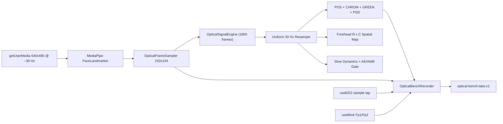

import { Callout, Cards } from 'nextra/components'

# Optical Physiological Bench

A quantitative optical recording and signal-analysis bench in the [experiences gallery](/software/features/experiences). It treats an RGB webcam as a timestamped optical instrument, preserves unmodified spatial RGB series alongside derived physiological estimates, and records concurrent PiEEG bio channels on a monotonic timebase.

Open it from **cloud.pieeg.com** (or the self-hosted dashboard) -> **`V`** -> **Optical Physiological Bench**. Registry id: `optical-bench`. Tag: `Lab / Optical`.

<Callout type="warning">
  Every output in the bench is tagged with an explicit measurement tier. Raw RGB intensities (Tier 1) depend on ambient illumination, surface specular reflection, and camera ISP settings. rPPG pulse waveforms and BPM (Tier 2) require stationary framing and adequate spectral SNR. Spatial pulsation maps, slow optical trends, and optical pulse-interval variability (Tier 3) are experimental research metrics: they are **not** clinical SpO2, quantitative cerebral perfusion, fNIRS hemodynamics, or ECG-equivalent HRV.
</Callout>

## Three-tier measurement taxonomy

The bench separates direct sensor readouts from model-derived estimates and experimental spatial/interval metrics in both the UI (`TierBadge`) and exported files (`SCIENTIFIC_CAVEATS`):

| Tier | Identifier | Badge | What it includes |
|---|---|---|---|
| **Tier 1** | `direct_optical` | `T1 · Direct Optical` | Spatial mean `R, G, B` (0-255 DN), spatial green standard deviation, saturation clipping ratio (`<= 4` or `>= 251` DN), and normalized chromaticity $r = R/(R+G+B)$, $g = G/(R+G+B)$ per anatomical ROI and forehead grid cell, plus an ambient background reference patch. |
| **Tier 2** | `algorithm_estimate` | `T2 · Algorithm Estimate` | Uniformly resampled (30 Hz), detrended, zero-phase bandpass-filtered rPPG waveforms (`POS`, `CHROM`, `GREEN`) in parts per thousand ($\text{ppt} = 1000 \cdot \Delta I / I$), Hann-windowed PSD spectrum, dominant pulse rate (BPM), and De Haan spectral SNR (dB). |
| **Tier 3** | `experimental_metric` | `T3 · Experimental Metric` | Forehead virtual sensor array ($R \times C$) pulsation amplitude, SNR quality, and spatial coherence maps; slow optical dynamics ($< 0.15\text{ Hz}$ RGB and chromaticity drift); and SNR-gated pulse-interval statistics (`instantBpm`, `meanIbiMs`, `sdnnOptMs`, `rmssdOptMs`, `pavCvPct`). |

## What it is (and is not)

| It is | It is not |
|---|---|
| A timestamped optical + bio time-series recorder and reprocessing bench | A clinical monitor, pulse oximeter, or blood-pressure estimator |
| Simultaneous `POS`, `CHROM`, and `GREEN` rPPG executed on identical frames | A single opaque BPM number without waveform or spectral SNR context |
| A bilinear forehead virtual sensor array ($2\times 2$, $3\times 4$, or $4\times 6$) | A quantitative blood-flow, laser speckle, or fNIRS perfusion imager |
| Raw ROI and grid RGB preserved unmodified for offline filter/algorithm sweeps | A pixel video archive by default (camera pixels are downsampled to polygon means unless optional WebM is ticked) |
| Concurrent PiEEG bio capture (`useEEG` sample tap + `useBlink` EOG marks) | Hardware-synchronized optical and electrophysiological sampling |

## Live loop



1. **Camera acquisition** - `facingMode: "user"`, ideal `640x480` at `30 Hz`, no audio. Track settings (`width`, `height`, `reportedFrameRate`, `exposureMode`, `whiteBalanceMode`) are inspected via `MediaStreamTrack.getSettings()` and stored in session metadata.
2. **Anatomical ROI tracking** - MediaPipe `FaceLandmarker` (`@mediapipe/tasks-vision@0.10.34`, float16 model, `VIDEO` mode, GPU delegate with CPU fallback). If landmark detection is offline or no face is present, the sampler falls back to static center-framed polygons and marks `facePresent: false`.
3. **Offscreen polygon sampling** - `OpticalFrameSampler` draws each video frame into a `192x144` offscreen canvas (`willReadFrequently: true`) and computes exact point-in-polygon spatial averages (`r`, `g`, `b`, `spatialStd`, `clippedRatio`, `chromR`, `chromG`, `pixelCount`) across 5 ROIs and $R \times C$ forehead grid cells.
4. **Uniform temporal resampling** - Browser frame delivery is irregular. `resampleRgbUniform` linearly interpolates raw `(camT, R, G, B)` onto a uniform `30 Hz` grid (`UNIFORM_ANALYSIS_HZ = 30`) before digital filtering or spectral estimation.
5. **Decoupled analysis cadence** - Frame extraction runs up to ~30 Hz; full multi-algorithm rPPG, spatial grid coherence, and slow dynamics run every 5th frame (~6 Hz) inside `OpticalSignalEngine` (rolling buffer of `1800` frames, ~60 s) so canvas rendering stays smooth.
6. **Concurrent bio + blink capture** - While recording, `subscribeEegSamples` writes incoming PiEEG channel frames (`BIO_CHUNK = 4096`) and confirmed frontal EOG blinks from [`useBlink`](/software/features/detectors#useBlink) append `{ t, text: "eog_blink", source: "blink" }` event markers.

## Five-panel workbench layout

| Panel | Surface | Contents |
|---|---|---|
| **Panel 1** | Camera View & ROI Sensor Array (`T1`) | Mirrored video + 2D overlay of active skin ROIs, ambient reference patch, $R \times C$ forehead grid, optional viridis/plasma-style optical heatmap, live forehead RGB and chromaticity `(r, g)` HUD. |
| **Panel 2** | Real-Time Optical & Physiological Signals | Multi-lane canvas: Raw RGB traces, processed rPPG waveforms (`POS`, `CHROM`, `GREEN` overlay), Hann PSD spectrum (`0.5 - 4.2 Hz`) + rolling BPM trend, selected regional cell waveform (`Frc`), slow optical drift traces, per-ROI BPM/SNR bar, and collapsible **Live Biosignals Dock** (`ChannelCanvas` + `SpectralPanel`). |
| **Panel 3** | Spatial Optical Pulsation Mapping (`T3`) | Interactive $R \times C$ forehead sensor array + $N_{\text{cells}} \times N_{\text{cells}}$ pairwise correlation matrix, 5 spatial map modes, **Identical-Frame Algorithm Comparison** table, and **Pulse-Derived & Interval Metrics** card. |
| **Panel 4** | Acquisition & Processing Controls | Primary algorithm selector, grid resolution (`2x2`, `3x4`, `4x6`), analysis window (`6`, `10`, `15`, `20 s`), detrending mode, bandpass cutoffs, SNR gate, slow drift window (`15`, `30`, `45 s`), active ROI toggles, SNR-weighted multi-ROI fusion, **Reprocess Buffer / Take**, and **Reference Validation Dataset Loader**. |
| **Panel 5** | Recording & Session Export | Session metadata (`sessionName`, `subjectId`, `lightingCondition`, `notes`), manual event marker input (`M`), Start/Stop recording (`Space`), optional `MediaRecorder` WebM video capture, CSV export, JSON export, and JSON session import. |

## Tracked ROIs & forehead virtual sensor grid

### Anatomical ROIs

| ROI ID | Label | Skin | Landmarks / Geometry |
|---|---|---|---|
| `forehead` | Forehead (Primary) | Yes | 6 FaceMesh anchors: top `103, 10, 332`, bottom `65, 9, 295`, inset 12% from hairline and 18% from eyebrows to stay on glabrous frontal skin. |
| `left_cheek` | Left Malar Cheek | Yes | 8-point zygomatic/malar polygon (`116, 117, 118, 101, 36, 205, 187, 123`). |
| `right_cheek` | Right Malar Cheek | Yes | 8-point zygomatic/malar polygon (`345, 346, 347, 330, 266, 425, 411, 352`). |
| `glabella` | Glabella | Yes | 8-point inter-brow patch (`107, 66, 105, 9, 334, 296, 336, 151`). |
| `ambient_ref` | Ambient Background Ref | No | Static top-left corner rectangle (`x: 0.02..0.14`, `y: 0.03..0.15`) used to separate room illumination or camera exposure shifts from skin color changes. |

### Forehead bilinear virtual sensor grid

The forehead polygon is partitioned into $R \times C$ quadrilateral cells (`2x2 = 4`, `3x4 = 12` default, or `4x6 = 24` virtual sensors) labeled `F11` through `F{R}{C}`. Cell vertices are computed via piecewise bilinear interpolation across the 6 forehead anchors so the sensor grid tracks head translation, roll, and forehead curvature.

### Multi-ROI SNR-weighted fusion

When **SNR-Weighted Multi-ROI Fusion** (`combineRois`, default `true`) is enabled and multiple skin ROIs are active, each ROI's resampled RGB series is weighted by its current spectral SNR before running the primary and comparison rPPG pipelines:

$$
w_k = \max\left(0.2,\; 10^{\,\text{clamp}(\text{SNR}_k,\, -5,\, 8) / 20}\right)
$$

## Signal processing & rPPG algorithms (Module A)

All three rPPG algorithms run simultaneously on the **exact same resampled RGB window** so algorithm performance can be compared without confounding frame or ROI differences.

| Algorithm | Citation | Formulation |
|---|---|---|
| `GREEN` | Verkruysse et al. (2008) | Temporal mean-normalized green absorption baseline, inverted so systolic blood-volume increase maps to a positive peak: $s(t) = -(G(t) - \mu_G) / \mu_G$. |
| `POS` | Wang et al. (2017) | Sliding sub-window (`1.6 s`) overlap-add projection onto the plane orthogonal to `[1, 1, 1]`. With $C_n(t) = C(t)/\mu_C - 1$: $S_1 = G_n - B_n$, $S_2 = G_n + B_n - 2R_n$, $h = S_1 + (\sigma(S_1)/\sigma(S_2)) S_2$, negated and overlap-normalized. |
| `CHROM` | De Haan & Jeanne (2013) | Chrominance ratio projection: $X_s = 3R_n - 2G_n$, $Y_s = 1.5R_n + G_n - 1.5B_n$. Both components are zero-phase bandpass-filtered to $X_f, Y_f$ and combined as $S = X_f - (\sigma(X_f)/\sigma(Y_f)) Y_f$. |

### Detrending & zero-phase bandpass filtering

1. **Detrending (`detrendSignal`)**:
   - `moving_average` (default): subtracts a centered local moving average with half-window $\approx f_s / (2 \cdot 0.75 f_{\text{low}})$.
   - `linear`: ordinary least-squares linear trend subtraction.
   - `none`: mean-centering only.
2. **Zero-phase bandpass (`bandpassZeroPhase`)**: 2nd-order biquad bandpass filter (`lowCutHz` default `0.75 Hz` / 45 BPM, `highCutHz` default `3.5 Hz` / 210 BPM) applied forward and backward (`filtfilt`-style) to eliminate phase lag and preserve systolic peak timing.
3. **Scaling**: Filtered waveforms are scaled by $1000\times$ into parts per thousand (`ppt`).

### Spectral PSD & De Haan SNR

`computePulseSpectrumAndSnr` applies a Hann window and evaluates a discrete Fourier transform across `[0.5 Hz, 4.2 Hz]` at `0.025 Hz` (1.5 BPM) spacing, followed by 3-point parabolic interpolation around the passband peak bin for sub-bin frequency resolution.

Spectral SNR (De Haan & Jeanne, 2013) is computed in dB as the power ratio of the fundamental ($\pm 0.12\text{ Hz}$ around $f_0$) plus second harmonic ($\pm 0.15\text{ Hz}$ around $2f_0$) to all remaining in-band noise power:

$$
\text{SNR}_{\text{dB}} = 10 \log_{10}\left(\frac{P(f_0 \pm 0.12\text{ Hz}) + P(2f_0 \pm 0.15\text{ Hz})}{P_{\text{passband}} - P_{\text{signal}}}\right)
$$

Confidence is mapped linearly from $\text{SNR}_{\text{dB}} \in [-3, +8]\text{ dB}$ onto $[0, 1]$.

## Spatial optical pulsation mapping (Module B)

Each forehead cell `Frc` is resampled to 30 Hz and analyzed with the active primary algorithm. Clicking any cell in Panel 3 selects that virtual sensor (`selectedCellIndex`) and plots its regional waveform in Panel 2.

| Spatial Map Mode | Quantity | Definition |
|---|---|---|
| `pulsatile_amplitude` | Pulsatile Amp (`ppt`) | RMS standard deviation of the bandpass-filtered rPPG waveform in cell `Frc` (parts per thousand). |
| `signal_quality` | Quality / SNR | Per-cell confidence score $[0, 1]$ and spectral SNR (dB). |
| `unprocessed_variation` | Raw Unprocessed CV (`ppt`) | $(\sigma_{\text{raw } G} / \mu_{\text{raw } G}) \times 1000$ **before** bandpass filtering - separates raw motion/specular variance from cardiac pulsatility. |
| `slow_drift` | Slow Drift (`%`) | Percentage change in mean green intensity between the first 20% and last 20% of the analysis window. |
| `spatial_correlation` | Corr to Ref | Zero-lag Pearson correlation $r \in [-1, 1]$ between the cell's filtered pulse waveform and the global forehead reference waveform. |

Summary spatial metrics reported in Panel 3:
- **Pairwise correlation matrix**: $N_{\text{cells}} \times N_{\text{cells}}$ Pearson correlation across all virtual sensors.
- **Mean spatial coherence**: Narrowband magnitude-squared coherence with the reference pulse evaluated across $[f_0 - 0.08, f_0, f_0 + 0.08]\text{ Hz}$, averaged over all cells.
- **Amplitude uniformity**: $1 - \sigma(\text{amp}) / \mu(\text{amp})$ clamped to $[0, 1]$.

## Slow optical dynamics & lighting quality gates (Module C)

Over the configurable `slowWindowSec` (`15`, `30` default, or `45 s`), `computeSlowOpticalDynamics` measures baseline-relative percentage shifts relative to the first `1.5 s` of the window:

- **Smoothed RGB drift (`deltaRPct`, `deltaGPct`, `deltaBPct`)**: 2.5 s moving-average trend of $\Delta C / C_0 \times 100\%$.
- **Chromaticity trend (`chromDiffTrend`)**: Smoothed slow drift in normalized $(G - R)/(R + G + B)$.
- **Low-frequency oscillation (`lowFreqOscillation`)**: Zero-phase bandpass in `0.05 - 0.18 Hz` (Mayer-wave / vasomotor band) on $\Delta G\%$.
- **Interval A vs. Interval B comparison**: Splits the slow window into first half ($A$) and second half ($B$) and reports $\Delta R$, $\Delta G$, $\Delta B$ (in DN), $\Delta\text{ChromG}$ (%), and ambient shift (%).

### Ambient lighting, auto-exposure (AE), and auto-white-balance (AWB) alerts

Slow optical trends are easily confounded by room lighting or camera ISP adjustments. The bench flags `lightingShiftDetected: true` when any of three gates trip:

| Gate | Threshold | Diagnostic reason |
|---|---|---|
| Ambient reference drift | `\|ambientDriftPct\| > 4.5%` | Illumination or camera exposure shift detected on `ambient_ref` |
| Skin luminance step | `\|jumpG\| > 6.0%` within `0.4 s` | Sudden luminance step (camera auto-exposure or head motion) |
| Skin R-B chromaticity step | `\|jumpR - jumpB\| > 4.5%` within `0.4 s` | Sudden chromaticity step (camera auto-white-balance adjustment) |

## Gated pulse-derived metrics (Module D)

`computePulseDerivedMetrics` detects systolic peaks on the primary filtered waveform (`minPeakHeight = mean + 0.25 * std`, refractory `0.33 s` / max ~180 BPM) and applies three acceptance gates to each inter-beat interval ($\text{IBI}$):

1. **SNR gate**: `primary.snrDb >= config.snrThresholdDb` (default `1.5 dB`). If false, all peaks are marked `rejectReason: "low_snr"` and variability metrics read `Gated`.
2. **Physiological bounds**: `330 ms <= ibiMs <= 1600 ms` (37.5 - 181.8 BPM); otherwise `rejectReason: "out_of_bounds"`.
3. **Successive step gate**: `|ibiMs - prevAcceptedIbi| / prevAcceptedIbi <= 0.28` (28% max beat-to-beat step); otherwise `rejectReason: "step_change"`.

| Metric | Minimum accepted beats | Definition |
|---|---|---|
| `instantBpm` | $\ge 2$ IBIs | $60000 / \text{mean}(\text{last } 3 \text{ accepted IBIs})$ |
| `meanIbiMs` | $\ge 2$ IBIs | Arithmetic mean of accepted IBIs (ms) |
| `sdnnOptMs` | $\ge 3$ IBIs | Sample standard deviation of accepted optical IBIs (ms) |
| `rmssdOptMs` | $\ge 3$ IBIs | Root mean square of successive differences between accepted IBIs (ms) |
| `pavCvPct` | $\ge 3$ peaks | Pulse-amplitude variability coefficient of variation: $(\sigma_{\text{amp}} / \mu_{\text{amp}}) \times 100\%$ |

## Two clocks & technical validation strip

Optical frames and PiEEG bio samples are captured on **independent clocks** and are not resampled onto each other during recording:

| Stream | Timestamp at ingest | Source | Typical rate |
|---|---|---|---|
| **Optical (`camT`, `procT`)** | `performance.now() / 1000` | Monotonic browser clock at frame capture and after ROI extraction | ~30 Hz (resampled to 30 Hz for DSP) |
| **PiEEG Bio (`bioT`)** | `performance.now() / 1000` | Monotonic browser clock when `subscribeEegSamples` receives each board packet | ~250 Hz |
| **Event Markers (`events`)** | `performance.now() / 1000` | Manual (`M`), confirmed EOG blink (`useBlink`), or `quality_flag` | event-driven |

On recording start, `t0Sec` is latched and all exported timestamps (`camT`, `procT`, `bioT`, `events[].t`) are stored as seconds elapsed since `t0Sec`. Because board transport buffering introduces a variable offset between physical EEG sampling and browser packet arrival, `camT` and `bioT` share a common session zero rather than a hardware trigger pulse.

### Header technical validation strip

The top bar continuously reports 7 acquisition health indicators over the latest 120 frames:
- **FPS**: Measured frame rate (`>= 18 Hz` green).
- **dt / Jitter**: Mean inter-frame interval $\pm$ standard deviation in ms (`jitter < 15 ms` green).
- **Proc Latency**: Mean `(procT - camT) * 1000` in ms (`< 20 ms` green).
- **Continuity**: Percentage of consecutive frames with $\Delta t < 65\text{ ms}$ (`>= 90%` green).
- **ROI Track**: Percentage of frames with `facePresent === true` (`>= 85%` green).
- **Drops**: Estimated dropped frames when $0.085\text{ s} < \Delta t < 2.0\text{ s}$.
- **AE / AWB / Light**: `Stable` vs. `SHIFT DETECTED`.

## Reference validation datasets & offline reprocessing

### Built-in synthetic reference datasets

Panel 4 includes three deterministic 30 Hz synthetic datasets (`generateValidationDatasetFrames`) so algorithms, spectral SNR, spatial maps, and lighting shift detectors can be verified reproducibly without a camera:

| Dataset ID | True BPM | Duration | Scenario |
|---|---|---|---|
| `clean_66bpm` | `66.0 BPM` (`1.10 Hz`) | `14 s` | Stationary skin reflectance (`R=185, G=138, B=112`) with physiological blood-volume pulse (fundamental + 2nd harmonic) and low sensor noise. |
| `specular_motion_78bpm` | `78.0 BPM` (`1.30 Hz`) | `14 s` | 78.0 BPM pulse contaminated by a strong `1.95 Hz` common-mode specular intensity oscillation across `R, G, B` - degrades single-channel `GREEN` while `POS` and `CHROM` reject the common-mode component. |
| `lighting_step_72bpm` | `72.0 BPM` (`1.20 Hz`) | `16 s` | 72.0 BPM pulse with a `0.08 Hz` Mayer-wave drift and an `+8.5%` ambient illumination step at $t = 8.0\text{ s}$ (automatically marks `illumination_step_+8.5pct`). |

### Offline reprocessing (`reprocessSessionTake`)

Because every recorded sample row preserves unmodified `roiRgb` (`forehead`, `left_cheek`, `right_cheek`, `glabella`, `ambient_ref`) and `gridRgb` ($3 \times R \times C$ floats), clicking **Reprocess Buffer / Take** in Panel 4 reconstructs the raw optical frame sequence and re-runs `OpticalSignalEngine` with any updated algorithm, filter band, detrending mode, ROI selection, or SNR gate. Derived columns (`posWave`, `chromWave`, `greenWave`, `bpm`, `snrDb`, `confidence`, `instantBpm`, `slowDelta*`) are updated in place before CSV/JSON export without altering the raw RGB measurements.

## Take format `optical-bench-take:v1`

### JSON export (`{session}_{YYYYMMDD_HHMMSS}.json`)

```json
{
  "format": "optical-bench-take:v1",
  "metadata": {
    "sessionName": "forehead_rppg_run01",
    "subjectId": "S01",
    "lightingCondition": "indoor_diffuse_led",
    "notes": "",
    "createdAtIso": "2026-10-17T12:00:00.000Z",
    "algorithmVersion": "rppg-core:1.0.0",
    "cameraSettings": {
      "width": 640,
      "height": 480,
      "reportedFrameRate": 30,
      "deviceLabel": "USB Camera",
      "exposureMode": "continuous",
      "whiteBalanceMode": "continuous"
    },
    "processingConfig": {
      "primaryAlgorithm": "POS",
      "compareAllAlgorithms": true,
      "windowSec": 10,
      "lowCutHz": 0.75,
      "highCutHz": 3.5,
      "detrendMode": "moving_average",
      "snrThresholdDb": 1.5,
      "gridRows": 3,
      "gridCols": 4,
      "activeRois": ["forehead", "left_cheek", "right_cheek"],
      "combineRois": true,
      "slowWindowSec": 30
    }
  },
  "durationSec": 30.0,
  "gridRows": 3,
  "gridCols": 4,
  "caveats": [
    "[Tier 1 - Direct Optical] ...",
    "[Tier 2 - Algorithm Estimate] ...",
    "[Tier 3 - Experimental Metric] ..."
  ],
  "events": [
    { "t": 4.12, "text": "eog_blink", "source": "blink" },
    { "t": 10.0, "text": "breath_hold", "source": "manual" }
  ],
  "samples": [
    {
      "camT": 0.0,
      "procT": 0.002,
      "latencyMs": 2.1,
      "facePresent": true,
      "trackingConfidence": 0.94,
      "motionSpeed": 0.012,
      "qualityFlags": {
        "facePresent": true,
        "trackingConfidence": 0.94,
        "motionArtifact": false,
        "illuminationShift": false,
        "saturationClipped": false,
        "snrPass": true,
        "overallValid": true
      },
      "roiRgb": {
        "forehead": { "r": 184.2, "g": 137.8, "b": 111.5, "clipped": 0 },
        "left_cheek": { "r": 188.1, "g": 140.2, "b": 113.0, "clipped": 0 },
        "right_cheek": { "r": 182.0, "g": 136.1, "b": 110.4, "clipped": 0 },
        "glabella": { "r": 186.0, "g": 139.0, "b": 112.1, "clipped": 0 },
        "ambient_ref": { "r": 90.0, "g": 90.0, "b": 90.0, "clipped": 0 }
      },
      "gridRgb": [184.1, 137.9, 111.4, "...3 x gridRows x gridCols values"],
      "posWave": 0.412,
      "chromWave": 0.389,
      "greenWave": 0.351,
      "bpm": 66.0,
      "snrDb": 5.42,
      "confidence": 0.765,
      "instantBpm": 65.8,
      "slowDeltaRPct": 0.02,
      "slowDeltaGPct": -0.04,
      "slowDeltaBPct": 0.01
    }
  ],
  "bio": {
    "sampleRate": 250,
    "channels": 8,
    "t": [0.0, 0.004, "..."],
    "ch": ["...frame-major packed µV samples"]
  }
}
```

### CSV export (`{session}_{YYYYMMDD_HHMMSS}.csv`)

Each row corresponds to one optical frame and contains 36 fixed columns followed by $3 \times R \times C$ forehead virtual sensor columns (`F11_R, F11_G, F11_B, ..., F{R}{C}_B`):

- **Timing & tracking**: `cam_t_sec`, `proc_t_sec`, `latency_ms`, `face_present`, `tracking_conf`, `motion_speed`
- **Quality gates**: `overall_valid`, `motion_artifact`, `illumination_shift`, `saturation_clipped`, `snr_pass`
- **Raw ROI RGB (`T1`)**: `forehead_R/G/B`, `left_cheek_R/G/B`, `right_cheek_R/G/B`, `glabella_R/G/B`, `ambient_ref_R/G/B`
- **Derived rPPG (`T2`)**: `rppg_POS_ppt`, `rppg_CHROM_ppt`, `rppg_GREEN_ppt`, `pulse_bpm`, `instant_bpm`, `snr_db`, `confidence`
- **Slow drift (`T3`)**: `slow_delta_R_pct`, `slow_delta_G_pct`, `slow_delta_B_pct`
- **Virtual sensor grid (`T1`)**: `F11_R`, `F11_G`, `F11_B` ... `F{R}{C}_R`, `F{R}{C}_G`, `F{R}{C}_B`

## Controls

| Input | Action |
|---|---|
| **Space** | Start / Stop recording (`OpticalBenchRecorder` + optional `MediaRecorder` WebM) |
| **M** / `+ Marker` | Insert timestamped event marker on the session timeline |
| **Click cell in Panel 3** | Select forehead virtual sensor `Frc` for regional waveform inspection in Panel 2 |
| **Click row in Algorithm Table** | Switch primary rPPG algorithm (`POS`, `CHROM`, `GREEN`) |
| **Reprocess Buffer / Take** | Re-run DSP pipeline on preserved raw RGB with current Panel 4 parameters |
| **Load & Verify** | Populate engine and recorder with a deterministic reference dataset |
| **Export CSV / JSON** | Download timestamped optical table or full multimodal session bundle |
| **Import JSON** | Load a saved `optical-bench-take:v1` file and reconstruct frames for offline inspection |
| **Esc** | Exit to experiences gallery (or collapse expanded channel in the Live Biosignals Dock) |

## Limits

- Standard 8-bit RGB webcams are subject to sensor shot noise, rolling-shutter compression, and browser-managed auto-exposure / auto-white-balance unless locked in OS camera drivers.
- Head motion (`motionSpeed > 0.25`), facial occlusion, and uneven shadows degrade pulse SNR; `POS` and `CHROM` reduce specular reflection artifacts relative to `GREEN` but do not eliminate large motion transients.
- Spatial forehead maps reflect relative optical AC/DC modulation across skin patches, not calibrated depth-resolved perfusion or cortical hemodynamics.
- Optical inter-beat intervals (`sdnnOptMs`, `rmssdOptMs`) include vascular pulse-transit dispersion and peak-interpolation jitter at 30 Hz; they are gated when `snrDb < snrThresholdDb` and must not be equated with clinical ECG HRV.
- Optical and PiEEG bio streams run on independent clocks without hardware trigger synchronization.

## Related

<Cards>
  <Cards.Card title="Experiences gallery" href="/software/features/experiences" />
  <Cards.Card title="BioPose Recorder" href="/software/features/biopose" />
  <Cards.Card title="Aura Dataset Lab" href="/software/features/aura-dataset" />
  <Cards.Card title="Detectors" href="/software/features/detectors" />
  <Cards.Card title="Recording & Replay" href="/software/features/recording" />
</Cards>
